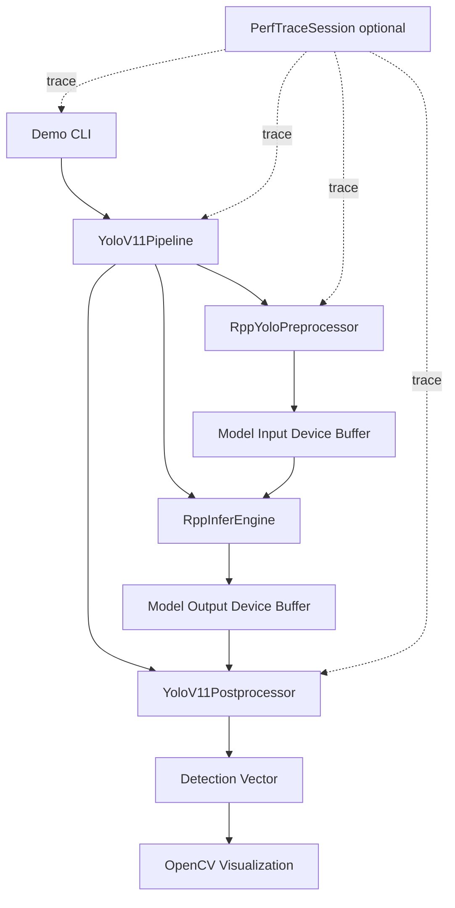
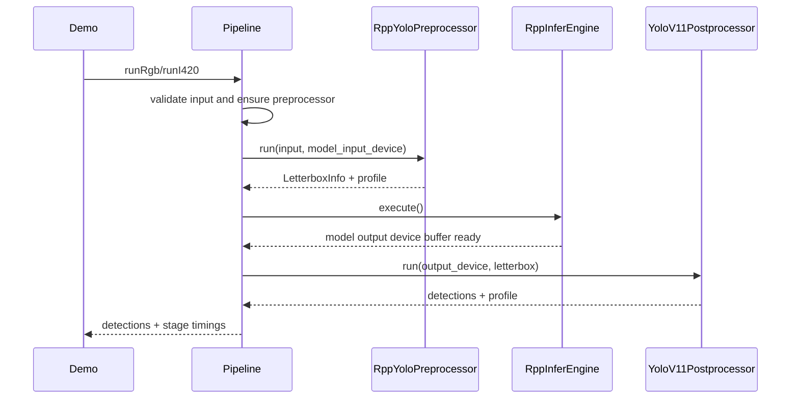

# 1. 背景与目标

YOLOv11 RPP 推理 Demo V2.0 目标是提供可复用、可测试、可扩展的 OpenRT on RPP 推理工程。

核心目标：

- 使用 C++17 和 CMake 构建统一工程。
- 提供 RGB/BGR 图片输入 demo 和 I420 YUV 单帧输入 demo。
- Demo 执行代码统一基于 OpenRT 运行在 RPP 硬件上。
- 将推理流程拆分为 Inference、RPP 前处理、RPP 后处理和 YOLOv11 应用层。
- 将 demo 入口限制在命令行解析、warmup、测量、可视化和结果输出。
- 仓库不跟踪 ONNX 模型文件，`scripts/build.sh` 默认准备 `weights/yolov11s.onnx`；demo 二进制仍支持通过 `--onnx` 指定模型。
- 支持可选 `rpp_perf` trace，用于性能分析和运行时事件关联。
- 提供 `scripts/build.sh`、`scripts/run.sh`、`scripts/benchmark.sh` 作为标准构建、运行和性能测量入口。

# 2. 设计范围

## 2.1 包含范围

| 模块        | 范围                                                         |
| ----------- | ------------------------------------------------------------ |
| 构建系统    | 根 `CMakeLists.txt`，构建共享库和两个 demo 可执行文件        |
| Inference   | `rpp/inference/RppInferEngine`，负责 ONNX 解析、engine 构建、buffer 绑定和同步推理 |
| Preprocess  | `rpp/preprocess/RppYoloPreprocessor`，负责输入上传、letterbox、颜色转换、resize、normalize |
| Postprocess | `rpp/postprocess/YoloV11Postprocessor`，负责 YOLOv11 输出 layout 解析、NMSPREPlugin、OpenRT `addNMS` 和 CPU fallback |
| Pipeline    | `src/yolov11/YoloV11Pipeline`，串联前处理、推理和后处理        |
| Demo        | `demos/rgb_image` 和 `demos/yuv_frame`                       |
| Perf        | `src/perf/PerfTraceSession`，由 CMake 选项控制               |
| Scripts     | `scripts/build.sh`、`scripts/run.sh`、`scripts/benchmark.sh`，提供标准命令入口 |

# 3. 总体架构



V2.0 使用分层结构隔离职责：

- `demos/`：只保留用户入口、参数解析、warmup、测量循环和输出。
- `src/yolov11/`：保留 YOLOv11 业务对象、pipeline、label 和可视化逻辑。
- `rpp/`：保留可在 RPP 硬件上运行的模块化执行路径，包括前处理、Inference 和后处理。
- `src/utils/`：保留日志、路径、buffer 等公共工具。
- `src/perf/`：保留可选性能 trace 封装。

# 4. 目录设计

```text
YOLOv11/
├── CMakeLists.txt
├── README.md
├── ReleaseNote.md
├── 3rd_party/
├── assets/
├── demos/
│   ├── rgb_image/
│   └── yuv_frame/
├── docs/
│   ├── README.md
│   └── api/
│       └── README.md
├── weights/
│   └── yolov11s.onnx
├── report/
├── rpp/
│   ├── preprocess/
│   ├── postprocess/
│   └── inference/
├── scripts/
│   ├── build.sh
│   ├── run.sh
│   └── benchmark.sh
├── src/
│   ├── utils/
│   ├── perf/
│   └── yolov11/
```

注意：`weights/` 保留目录结构，ONNX 模型文件不作为版本跟踪对象。

# 5. 模块文档与注释设计

每个模块都应提供独立 `README.md`，用于说明模块功能、快速移植方法和 API 接口。

模块 README 应包含：

- 模块职责和边界。
- 主要类、函数和数据结构。
- 输入输出约束。
- 典型调用流程。
- 快速移植和复用建议。

项目代码应使用 Doxygen 风格注释。文件、类、结构体、公共接口和关键内部函数应说明功能、输入输出类型和实现流程。函数内部关键代码注释应保持简要完整，用于快速理解实现步骤，避免重复描述显而易见的语句。

## 5.1 README 设计

项目 README 采用分层导航结构，用于支持首次验证、模块理解和后续移植。

README 设计原则：

- 公开 README 文档采用中英文双语结构，并提供语言章节跳转。
- 根 `README.md` 作为用户首次使用入口，包含 Quick Start、脚本构建运行、benchmark、直接执行二进制、仓库目录和文档导航。
- 根 `README.md` 的路径说明应使用“路径 + 简要描述”的形式，路径本身提供可点击跳转，避免只在正文中隐藏链接。
- `demos/rgb_image/README.md` 和 `demos/yuv_frame/README.md` 分别说明对应 demo 的输入格式、构建命令、运行脚本、benchmark 命令、直接二进制执行方式、参数和输出。
- `docs/README.md` 作为公开文档入口，负责跳转到 API 文档和后续公开文档。
- `docs/api/README.md` 作为可复用 API 索引，链接到 pipeline、RPP 前处理、RPP 后处理、Inference、utils 和 perf 等模块说明。
- `rpp/README.md` 作为 RPP 模块入口，说明 inference、preprocess、postprocess 的职责边界和数据流。
- `src/perf/README.md` 说明可选 `rpp_perf` trace 的构建方式、输出目录和使用边界。
- `src/yolov11/`、`src/utils/` 等模块 README 用于说明模块职责、主要接口、输入输出约束和快速移植建议。

README 与脚本关系：

- 根 README 中的 Quick Start 以 `scripts/build.sh` 和 `scripts/run.sh` 为默认入口。
- 根 README 中说明 `scripts/run.sh` 默认串行运行 RGB 和 YUV demo，`scripts/benchmark.sh` 默认对全部 demo 执行测量并保存日志。
- demo README 中同时保留脚本入口和直接二进制入口；脚本入口用于首次验证，二进制入口用于开发者确认参数和集成方式。
- README 中涉及默认模型时统一描述为 `weights/yolov11s.onnx`，并说明模型文件不纳入 Git 跟踪，由构建脚本检查和准备。

# 6. 构建设计

根 `CMakeLists.txt` 使用 CMake 3.16.3 和 C++17，构建以下目标：

| Target                   | 类型           | 说明                                               |
| ------------------------ | -------------- | -------------------------------------------------- |
| `yolov11_utils`           | shared library | 日志、工具和 buffer 辅助                           |
| `perf_trace`             | shared library | 可选 `rpp_perf` trace 封装                         |
| `rpp_yolo_preprocess`    | shared library | RPP 前处理模块和 CUDA/RPP kernel                   |
| `aeosnmspre`             | shared library | YOLOv11 NMSPRE plugin，用于 boxes/scores 拆分和转置 |
| `rpp_inference`          | shared library | Inference engine 封装                              |
| `rpp_yolov11_postprocess` | shared library | YOLOv11 后处理模块                                  |
| `yolov11_core`            | shared library | YOLOv11 pipeline 和 labels                          |
| `yolov11_visualization`   | shared library | 检测框绘制和图片保存                               |
| `yolov11_rgb_image_demo`  | executable     | RGB/BGR 图片 demo                                  |
| `yolov11_yuv_frame_demo`  | executable     | I420 YUV 单帧 demo                                 |

构建输出目录：

```text
build/bin/      demo executables
build/lib/      shared libraries
build/assets/   copied sample inputs
build/output/   rendered detection images
build/trace/    optional rpp_perf traces
build/logs/     script and benchmark logs
```

关键依赖：

| 依赖                          | 用途                                       |
| ----------------------------- | ------------------------------------------ |
| OpenRT under `/usr/local/rpp` | ONNX inference、RPP kernel API、NMS engine |
| OpenCV core/imgproc/imgcodecs | 图片读取、YUV 转可视化 BGR、结果渲染       |
| argparse header-only          | demo CLI                                   |
| pthread                       | inference/perf 支持                        |

## 6.1 脚本入口设计

| 脚本                   | 职责                                                    | 关键参数                                                     |
| ---------------------- | ------------------------------------------------------- | ------------------------------------------------------------ |
| `scripts/build.sh`     | 准备默认模型，清理上一次构建产物，执行 CMake 配置和编译 | build dir、perf 开关、skip-model                             |
| `scripts/run.sh`       | 默认串行运行全部 demo，也支持单独运行 RGB 或 YUV demo   | model path、demo type、input path、output path、build dir、loop、YUV size |
| `scripts/benchmark.sh` | 默认对全部 demo 执行测量，并自动保存控制台日志          | model path、demo type、input path、loop、YUV size            |

脚本应只封装标准命令入口，不改变 demo 二进制的参数语义。

模型管理设计：

- 默认模型路径为 `weights/yolov11s.onnx`。
- `weights/` 目录保留在仓库中，ONNX 模型文件不纳入版本控制。
- `scripts/build.sh` 在未指定 `--skip-model` 时检查默认模型是否存在并校验 MD5/SHA256；模型缺失或校验失败时重新下载。
- 默认模型下载到临时文件并完成校验后再替换正式路径，避免中断下载产生损坏模型。
- 默认模型获取方式：

```bash
mkdir -p weights
cd weights
wget -O yolov11s.onnx <TBD: YOLOv11 ONNX model URL>
echo "<TBD: checksum>  yolov11s.onnx" | md5sum -c -
```

注意：默认模型 URL、文件名和 checksum 必须在模型发布后确认。若交付模型命名采用 `yolo11s.onnx` 或其他名称，应同步更新脚本、README 和 demo 默认参数。

构建清理设计：

- `scripts/build.sh` 每次构建前清理 build 目录下的 CMake 缓存、二进制、库、复制资产、输出图片、trace 和日志等生成物。
- 清理逻辑必须拒绝 `/` 和仓库根目录作为 build dir。
- 源码、`assets/` 和 `weights/` 不作为构建清理对象。

运行脚本设计：

- `scripts/run.sh` 默认 `--demo all`，按 RGB demo、YUV demo 的顺序串行执行，保证日志和输出文件可预测。
- 当 `--demo all` 时不接受单个 `--input` 或 `--output`，因为 RGB 图片和 I420 YUV 帧输入格式不同。
- 相对路径统一按仓库根目录解析，避免从不同工作目录执行脚本时默认资源路径失效。
- 如果 `/usr/local/rpp/bin/rpp_server` 存在且未运行，脚本在执行 demo 前启动该服务，并将日志写入 `build/logs/rpp_server.log`。

Benchmark 脚本设计：

- `scripts/benchmark.sh` 通过 `scripts/run.sh` 执行实际 demo，复用路径解析和 `rpp_server` 保护逻辑。
- 默认 `--demo all`、`--loop 20`。
- benchmark 日志保存到 `build/logs/benchmark_<demo>_<timestamp>.log`。

# 7. Inference 推理设计

`RppInferEngine` 负责 OpenRT on RPP 推理生命周期：

1. 保存 ONNX 模型路径。
2. 解析 ONNX 并创建 engine。
3. 分配 input/output binding buffers。
4. 创建 execution context。
5. 暴露模型输入宽高、输出维度、输入输出 dtype。
6. 提供同步 `execute()`。

Pipeline 约束：

- 输入 tensor dtype 必须为 FP32。
- 输出 tensor dtype 必须为 FP32。
- 输出布局初始假设兼容常见 Ultralytics YOLO detection ONNX，最终以目标 YOLOv11 ONNX binding metadata 为准。
- 支持 `[C, N]`、`[N, C]`、`[1, C, N]`、`[1, N, C]` 输出布局。
- `C = 4 + class_count`，box 通道为 letterbox 模型输入空间下的 `(cx, cy, w, h)`。
- 模型 input width/height 和 output dimensions 在初始化后从 inference engine 派生。

# 8. 前处理设计

`RppYoloPreprocessor` 支持以下输入格式枚举：

| Format     | Demo 使用情况                                     |
| ---------- | ------------------------------------------------- |
| `BGR_HWC`  | RGB image demo 通过 OpenCV `imread` 得到 BGR 输入 |
| `YUV_I420` | YUV frame demo 使用 packed I420 单帧              |
| `RGB_HWC`  | 预留                                              |
| `RGB_CHW`  | 预留                                              |
| `NV12`     | 预留                                              |
| `NV21`     | 预留                                              |

前处理流程：

1. 校验输入尺寸、格式和 byte count。
2. Host 输入通过页锁定 Host 中转缓冲区和 DDR buffer 上传。
3. 计算 letterbox scale/padding。
4. 在 RPP 路径完成颜色转换、resize、normalize 和 NCHW model input 写入。
5. 输出 `LetterboxInfo`，供后处理恢复原图坐标。
6. 返回 `RppPreprocessProfile`，包含 H2D、resize/normalize 和 total timing。

Preprocessor 采用可复用 workspace：

- DDR source buffer。
- 页锁定 Host 中转缓冲区。
- SRAM input workspace。
- RGB CHW SRAM workspace。
- model input SRAM workspace。

Pipeline 在每次 run 后调用 `releaseSramBuffers()`，释放 SRAM workspace，避免长期占用 SRAM。

# 9. 推理 Pipeline 设计

`YoloV11Pipeline` 是 demo 复用的应用层入口。

公开接口：

| 接口                                                     | 说明                                                         |
| -------------------------------------------------------- | ------------------------------------------------------------ |
| `init(options, class_names)`                             | 初始化 OpenRT on RPP inference engine，派生模型 shape，初始化 RPP/RT_NMS postprocess |
| `runRgb(image, detections, times)`                       | 执行一张 BGR/RGB Host image                                  |
| `runI420(data, bytes, width, height, detections, times)` | 执行一帧 packed I420                                         |
| `runtimeConfig()`                                        | 返回实际运行配置                                             |

单次 run 的执行顺序：



测量字段：

| 字段               | 含义                                                         |
| ------------------ | ------------------------------------------------------------ |
| `input_h2d_ms`     | 输入 Host to Device 时间                                     |
| `input_h2d_bytes`  | 输入上传 byte count                                          |
| `preprocess_ms`    | 前处理总耗时                                                 |
| `inference_ms`     | OpenRT on RPP inference engine execute 耗时                  |
| `postprocess_ms`   | 后处理总耗时                                                 |
| `output_d2h_ms`    | compact result 或 fallback output Device to Host 时间        |
| `output_d2h_bytes` | 输出回传 byte count                                          |
| `end_to_end_ms`    | 单次 pipeline 端到端计算耗时，等于 `preprocess_ms + inference_ms + postprocess_ms` |

计时口径：

- `Input H2D` 和 `Output D2H` 必须继续单独测量并打印，用于观察数据搬运开销。
- `All time end to end` 只表示前处理、推理和后处理三个阶段之和，用于计算 FPS。
- Summary 中必须明确打印 `preprocess+inference+postprocess`，避免将 H2D/D2H 误解为端到端计算时间的一部分。

# 10. 后处理设计

`YoloV11Postprocessor` 负责把模型输出转换为最终 detection：

1. 初始化时根据模型输出 shape 和 class count 构建配置。
2. 解析 YOLOv11 输出 layout，识别 channel/anchor 轴。
3. 优先构建 `NMSPREPlugin` engine，将 YOLOv11 输出拆分为 boxes 和 scores。
4. 构建 OpenRT `addNMS` engine。
5. 分配 boxes、scores、thresholds、NMS outputs 等 device/host buffers。
6. 每次 run 时执行 pre-NMS、NMS、selected result D2H 和 detection 解析。
7. 当 RT_NMS 初始化或执行不支持当前 layout 时，回退到 CPU decode/NMS。
8. 根据 `LetterboxInfo` 将 box 坐标恢复到原图坐标。

默认配置：

| 参数                         | 默认值 |
| ---------------------------- | ------ |
| `score_threshold`            | `0.25` |
| `nms_threshold`              | `0.45` |
| `max_output_boxes_per_class` | `200`  |
| `agnostic`                   | `true` |
| `class_count`                | `80`   |

注意：YOLOv11 detection 导出通常不包含单独 `obj_conf` 字段时，后处理直接在 class scores 中选择最高类别分数，并基于 `score_threshold` 和 `nms_threshold` 过滤。若目标 ONNX 输出包含 `obj_conf`、已内置 NMS 或多输出头，需要在 `YoloV11Postprocessor` 中增加对应解析模式。

# 11. Demo 入口设计

## 11.1 RGB/BGR 图片 Demo

可执行文件：`yolov11_rgb_image_demo`

输入：

- `--onnx` / `-o`：可选，默认 `../../weights/yolov11s.onnx`，也可指定 YOLOv11-compatible ONNX 模型。
- `--image` / `-i`：默认 `../assets/test.jpg`。
- `--output`：默认 `../output/output_rgb.jpg`。
- `--loop` / `-l`：warmup 后测量循环次数。
- `--verbose` / `-v`：启用 verbose inference log。

标准脚本入口：

```bash
scripts/run.sh --demo rgb
scripts/benchmark.sh --demo rgb --loop 20
```

脚本入口按仓库根目录解析默认模型、输入和输出路径。直接执行 `build/bin/yolov11_rgb_image_demo` 时，调用方应显式传入模型、图片和输出路径，或从 `build/bin` 目录执行以使用二进制默认相对路径。

处理流程：

1. 解析并展开路径。
2. 校验模型和图片存在。
3. 使用 OpenCV 解码图片。
4. 初始化 `PerfTraceSession`。
5. 初始化 `YoloV11Pipeline`。
6. 执行一次 warmup。
7. 执行测量循环并汇总平均耗时。
8. 绘制检测框并保存图片。

标准 Summary 输出格式：

```text
Summary:
Loop count: <loop>
Loop time: average per measured loop after warmup
Input H2D: <ms> ms, <bytes> bytes, <KiB> KiB
Preprocess: <ms> ms
Inference: <ms> ms
Postprocess: <ms> ms
Output D2H: <ms> ms, <bytes> bytes, <KiB> KiB
All time end to end: <ms> ms (preprocess+inference+postprocess)
FPS: <fps>
Output path: <output>
```

## 11.2 I420 YUV 单帧 Demo

可执行文件：`yolov11_yuv_frame_demo`

输入：

- `--onnx` / `-o`：可选，默认 `../../weights/yolov11s.onnx`，也可指定 YOLOv11-compatible ONNX 模型。
- `--yuv`：默认 `../assets/test_0.yuv`。
- `--yuv-width`：默认 `1280`。
- `--yuv-height`：默认 `720`。
- `--output`：默认 `../output/output_yuv.jpg`。
- `--loop` / `-l`：warmup 后测量循环次数。
- `--verbose` / `-v`：启用 verbose inference log。

标准脚本入口：

```bash
scripts/run.sh --demo yuv
scripts/benchmark.sh --demo yuv --loop 20
```

脚本入口按仓库根目录解析默认模型、输入和输出路径。直接执行 `build/bin/yolov11_yuv_frame_demo` 时，调用方应显式传入模型、YUV 文件、YUV 尺寸和输出路径，或从 `build/bin` 目录执行以使用二进制默认相对路径。

特殊处理：

- 输入宽高必须为正偶数。
- YUV 文件按 I420 packed buffer 读取。
- Host 侧 `cv::cvtColor` 只用于生成可视化背景图，不参与推理输入前处理。

YUV demo 使用与 RGB demo 相同的 Summary 输出格式。`Input H2D` 和 `Output D2H` 仍单独打印；`All time end to end` 仍为 `Preprocess + Inference + Postprocess`，并作为 FPS 计算依据。

# 12. 性能 Trace 设计

`YOLO_ENABLE_RPP_PERF` 默认为 `OFF`。

启用方式：

```bash
cmake .. -DYOLO_ENABLE_RPP_PERF=ON
make -j8
```

启用后：

- demo 自动创建 `PerfTraceSession`。
- trace 文件输出到 `build/trace`。
- host scope 与 RPP driver records 可在同一 trace window 中关联。
- CLI 不暴露 perf 参数，避免运行时配置和构建配置混用。

# 13. 错误处理设计

Demo 采用 fail-fast 策略：

- CLI 解析失败直接打印 argparse help。
- 模型、图片、YUV 文件不存在时直接返回失败。
- 输入尺寸非法时直接返回失败。
- Inference 初始化失败时返回失败。
- 前处理、推理、后处理任一步失败时返回失败。
- 输出图片保存失败时返回失败。

该策略适合 demo 和 FAE 验证场景，便于定位配置和环境问题。