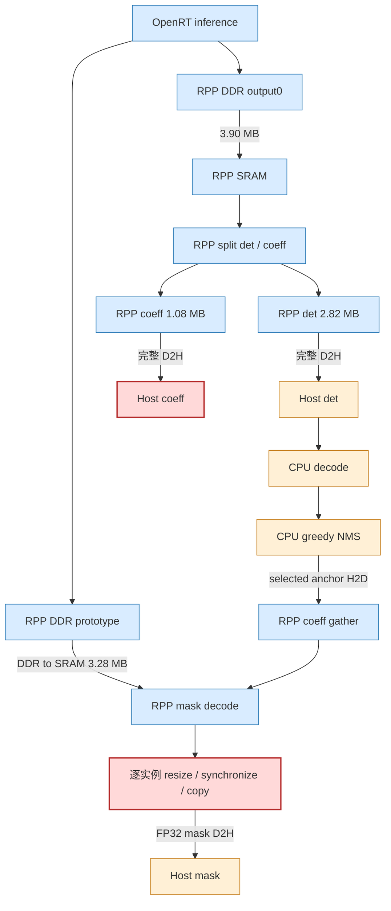

# YOLOv11-SEG demo优化记录

## 1. 各版本说明

以下内容用于快速说明每个版本主要解决的问题。详细修改从第3节开始按版本迁移顺序展开。


| 版本 | 说明                                                              | 作用                         |
| ---- | ----------------------------------------------------------------- | ---------------------------- |
| V0   | 初始版本CPU_NMS                                                   | E2E 407.78 ms，FPS 2.452     |
| V1   | 减少无效输出搬运，批量处理和回传 ROI mask                         | 输出到Host：298.60→37.58 ms |
| V2   | 优化后处理数据路径和 CPU 实现                                     | POST：116.13→63.644 ms      |
| V3   | 输出由 SRAM→DDR→Host 改为 pinned Host 上的异步 SRAM→Host       | 输出到Host：37.991→0.970 ms |
| V4   | metadata 直接 H2S、融合 mask kernel 队列、单次紧凑批量 ROI kernel | POST：66.526→48.207 mss     |
| V5   | 直读 combined output、坐标 LUT、SoA tile ROI 调度与 LUT 缓存      | POST：48.207→23.271 ms      |
| V6   | Sparse prototype ROI，仅计算最终ROI需要的prototype区域            | POST：23.271→8.079 ms       |
| V7   | CPU_NMS终版，统一stream、整理Runtime与资源生命周期                | 整理，End-to-end：20.521 ms  |

所有阶段互斥，不重复计时：

```text
End-to-end = H2D + PRE + INFER + POST + Output-to-Host
```

- `H2D`：输入 Host 到 Device DDR；包含 pageable Host→pinned Host 的 CPU staging copy。
- `PRE`：不含 H2D 的前处理计算和设备内部搬运。
- `INFER`：OpenRT 模型推理。
- `POST`：不含 Output-to-Host 的后处理计算、CPU处理和设备内部搬运。
- `Output-to-Host`：后处理结果回传 Host；V0～V2 为 SRAM→DDR→Host，V3 后为 SRAM→Host。

## 2. 各版本性能

以下结果使用同一模型和同一张`test.jpg`的单轮 measured-loop 快照，主要用于观察优化趋势，不作为严格控制变量实验。


| 版本                |      H2D |      PRE |     INFER |          POST |    输出到 Host |     End-to-end |        FPS |      输出数据量 |
| ------------------- | -------: | -------: | --------: | ------------: | -------------: | -------------: | ---------: | --------------: |
| V0 初始版本         | 1.089 ms | 1.485 ms | 10.652 ms |     95.950 ms | **298.604 ms** | **407.780 ms** |  **2.452** | 6,179,844 bytes |
| V1 减少无效搬运     | 1.002 ms | 1.512 ms |  9.389 ms |    116.137 ms |  **37.586 ms** | **165.627 ms** |  **6.038** | 5,104,644 bytes |
| V2 优化后处理       | 0.988 ms | 1.391 ms |  9.346 ms | **63.644 ms** |  **37.991 ms** | **113.360 ms** |  **8.821** |   805,761 bytes |
| V3 直接 S2H         | 1.002 ms | 1.496 ms |  9.294 ms | **66.526 ms** |   **0.970 ms** |  **79.289 ms** | **12.612** |   805,761 bytes |
| V4 优化 POST        | 1.015 ms | 1.509 ms |  9.320 ms | **48.207 ms** |   **0.986 ms** |  **61.037 ms** | **16.383** |   806,577 bytes |
| V5 等价 kernel 优化 | 1.002 ms | 1.491 ms |  9.027 ms | **23.271 ms** |   **0.967 ms** |  **35.757 ms** | **27.966** |   805,655 bytes |
| V6 Sparse ROI       | 1.025 ms | 1.467 ms |  9.008 ms |  **8.079 ms** |   **0.942 ms** |  **20.521 ms** | **48.730** |   805,759 bytes |
| V7 CPU_NMS          | 1.087 ms | 1.392 ms |  9.012 ms |  **8.167 ms** |   **0.983 ms** |  **20.642 ms** | **48.446** |   805,759 bytes |

核心结果：V0到V7的End-to-end由407.780 ms降至20.642 ms，FPS由2.452提升至48.446；其中V6完成主要计算量优化，V7主要整理Runtime和资源生命周期，性能与V6基本持平。

## 3. V0：初始架构与问题



V0 的主要不合理点：

1. 完整 `[32,8400]` coefficient 被回传到 CPU，但正常 mask 路径只需要 NMS 选中的少量 anchor。
2. 14 个实例 mask 逐个启动 kernel、逐个同步、逐个 SRAM→DDR→Host。
3. 最终二值 mask 使用 FP32 回传，数据量是 uint8 的 4 倍。
4. 完整 `[84,8400]` det 被回传 CPU，实际有效候选只有 122 个。
5. 多个 `rtStreamSynchronize()` 使搬运和计算完全串行。
6. CPU 后处理使用项目全局 `-O0` 编译。

## 4. V0→V1：减少无效搬运

### 修改的不合理行为


| V0 行为                             | V1 修改                                         |
| ----------------------------------- | ----------------------------------------------- |
| 全量 coefficient D2H                | 正常 RPP 路径取消；只有 CPU fallback 时延迟回传 |
| 每个实例单独 resize/crop kernel     | 改为一次批量 ROI mask kernel                    |
| 每个实例单独`rtStreamSynchronize()` | 改为批量 kernel 后同步一次                      |
| 每个实例单独 D2H                    | 所有 ROI mask 写入 packed buffer，一次 D2H      |
| 循环内重复创建临时回传路径          | 复用连续 device/SRAM/host buffer                |

- 取消的 D2H 数据量为 1,075,200 bytes，对应 `[32,8400]` FP32 coefficient。
- D2H 从 298.604 ms 降至 37.586 ms。
- 按五阶段口径，End-to-end 从约 407.780 ms 降至约 165.627 ms。
- FPS 从约 2.452 提升至约 6.038。
- mask 精度回归通过。

V1 仍存在：

- 完整 det 仍需 D2H，约 2.82 MB/frame。
- packed ROI mask 仍使用 FP32。
- prototype 每帧仍需 DDR→SRAM。
- metadata 仍需 Host→DDR→SRAM。
- 后处理仍存在多个同步点。

## 5. V1→V2：优化完整后处理

V2 不迁移 NMS 到 RPP，不改变 NMS 阈值、agnostic 模式和输出语义；优化范围包括 RPP 内部搬运、stream 生命周期、metadata 传输以及 CPU decode/NMS 实现。

### 优化RPP数据路径


| V1 行为                                                | V2 修改                                                                           |
| ------------------------------------------------------ | --------------------------------------------------------------------------------- |
| split 后 det 和完整 coeff 都执行 SRAM→DDR             | 正常路径只搬 det；coeff 保留在 SRAM，CPU fallback 才延迟搬运                      |
| split 和 mask decode 每帧分别创建/销毁 stream          | postprocessor 初始化时创建一个持久 stream，逐帧复用                               |
| selected index、box、mask offset 分别 H2D 和 DDR→SRAM | 三类 metadata 打包成一个连续 buffer，只执行一次 H2D 和一次 DDR→SRAM              |
| mask setup 包含多次小传输启动                          | 合并为 prototype copy + packed metadata copy                                      |
| 完整`[84,8400]` det D2H                                | RPP 完成 class argmax/threshold，仅回传七字段候选槽；CPU线性 compact 后继续原 NMS |
| ROI 二值 mask 使用 FP32 D2H                            | RPP 直接生成 packed uint8 ROI mask，数据量降为原来的 1/4                          |

独立后处理测试的关键变化：

```text
V1 profile_total_ms:        95.501 ms
V2 profile_total_ms:        59.598 ms

V1 mask_setup_copy_ms:      48.391 ms
V2 mask_setup_copy_ms:      15.935 ms

V1 output_d2h_bytes:     3,131,200 bytes（合成测试）
V2 output_d2h_bytes:       312,400 bytes（合成测试）

精度结果: PASS
```

当前 RPP 编译器会在动态 compact kernel 的 mark-merge pass 崩溃，因此 V2 采用 RPP 固定候选槽 + CPU 线性 compact。每个 anchor 只回传 7 个字段，det 数据从 2,822,400 bytes 降至 235,200 bytes；CPU greedy NMS 本身保持不变。

### 优化CPU实现


| V1 行为                             | V2 修改                                                    |
| ----------------------------------- | ---------------------------------------------------------- |
| 每保留一个框都重新创建`next vector` | 使用一次性`suppressed` 标记数组                            |
| NMS 循环反复复制候选 index          | index 只排序一次，之后原地标记 suppression                 |
| `keep` 动态增长                     | 根据`max_segments` 预留容量                                |
| IoU 调用函数并执行浮点除法          | 内联坐标/面积计算，使用`intersection > threshold × union` |
| C++ 后处理沿用全局`-O0`             | `rpp_yolov11_seg_postprocess` 的 C++ 部分单独启用 `-O3`    |
| decode 和 NMS 合并计时              | 拆成 decode、sort、NMS 和 candidate count                  |

### V2 CPU分项结果

真实图片：

```text
candidates: 122
kept: 14
candidate decode: 约 1.79～2.34 ms
score sort:       约 0.003～0.005 ms
greedy NMS:       约 0.005～0.007 ms
```

独立测试 20 轮平均：

```text
V1 decode + NMS: 4.018 ms
V2 decode + NMS: 2.219 ms
降低:             44.8%
```

阶段结论：CPU greedy NMS 已经降到约 0.006 ms，继续优化 NMS 算法没有明显工程收益。下一阶段如果迁移到 RPP，主要目标应该是消除完整 det D2H 和约 2.2 ms 的 CPU decode，而不是只节省 0.006 ms NMS。

## 6. V2→V3：输出直接SRAM→Host

V2 虽然已把输出数据量降至约 0.81 MB，但 candidate 和 mask 的实际回传路径仍各包含两次同步 Runtime 搬运：

```text
V2: RPP SRAM → RPP DDR → pageable Host
V3: RPP SRAM → pinned Host
```

### 修改内容


| V2 行为                                          | V3 修改                                                    |
| ------------------------------------------------ | ---------------------------------------------------------- |
| candidate slots 先 SRAM→DDR，再 DDR→Host       | `rtMemcpyAsync(..., rtMemcpySramToHost, stream_)` 直接回传 |
| packed uint8 mask 先 SRAM→DDR，再 DDR→Host     | 同一 stream 上直接异步 SRAM→Host                          |
| candidate/mask 使用`std::vector` pageable memory | 使用持久化`rtHostAlloc` pinned buffer，按需扩容并复用      |
| 两条输出各保留 DDR staging buffer                | 正常路径不再分配或访问对应 DDR staging buffer              |

CPU NMS 必须读取 candidate，因此每次直接 S2H 后仍执行一次 `rtStreamSynchronize()`。V3 的收益主要来自消除 DDR 中转和一次 Runtime copy 调用，并非跨帧计算/搬运重叠。

### V3实测结果

独立后处理测试，20 轮平均：

```text
                         V2          V3
candidate output copy: 16.996 ms → 0.353 ms
mask output copy:      17.405 ms → 0.265 ms
output copy total:     34.401 ms → 0.618 ms
profile total:         59.598 ms → 30.936 ms
output bytes:         312,400     → 312,400
accuracy:             PASS        → PASS
```

单轮对照：

```text
Output-to-Host: 37.991 ms → 0.970 ms
End-to-end:     ≈113.360 ms → ≈79.289 ms
FPS:            ≈8.821     → ≈12.612
```

## 7. V3→V4：压缩POST内部固定开销

V3 真实图片20轮详细基线确认，POST 约64.3 ms，主要由以下三项构成：

```text
mask setup（prototype D2S + metadata H2D→D2S）: 约16～17 ms
prototype combine（14个mask）:                 约13.5 ms
14次ROI resize/crop:                           约30.2 ms
CPU NMS:                                       约0.006 ms
```

### V4修改


| V3 路径                                         | V4 修改                                                                                                               |
| ----------------------------------------------- | --------------------------------------------------------------------------------------------------------------------- |
| metadata pageable Host→DDR→SRAM，两次同步调用 | metadata 使用持久化 pinned Host，`rtMemcpyAsync(..., rtMemcpyHostToSram)` 直接 H2S                                    |
| gather、combine、resize 后分别同步              | 三类 kernel 在同一 stream 连续排队，仅融合段末尾同步一次                                                              |
| 14个 ROI 分别启动 uint8 resize/crop kernel      | boxes、packed offsets 一并写入 metadata，一次紧凑批量 kernel 处理全部实际 ROI 像素                                    |
| 真实图只能看到 POST 总时间                      | `YOLO_POST_PROFILE=1` 输出 setup、gather、combine、ROI、融合等待、S2H、CPU mask 等分项；kernel 使用 device event 计时 |

批量 kernel 的第一版使用 `max_box_width × max_box_height × segment_count` 三维网格，padding 线程过多，融合段反而达到约59.5 ms。最终版本改为按 packed mask 总像素的一维紧凑调度，通过 offsets 定位所属 ROI，融合段降至约43.3 ms。该失败方案未作为 V4 最终实现保留。

### 精确POST分项

真实 `test.jpg`，122个候选、CPU NMS保留14个实例：


| 分项                        |          V3 |         V4 | 结论                                           |
| --------------------------- | ----------: | ---------: | ---------------------------------------------- |
| mask setup                  | 约16～17 ms |  约0.23 ms | 直接 H2S 消除了两次小搬运的 Runtime 固定开销   |
| coefficient gather          |   约0.20 ms |  约0.10 ms | 与后续 kernel 连续排队                         |
| prototype combine           |   约13.5 ms | 约13.34 ms | 主要是实际计算，基本没有继续下降               |
| ROI resize/crop             |   约30.2 ms | 约29.69 ms | 单次紧凑批量 launch 略有改善，主体仍是像素计算 |
| gather+combine+ROI 融合等待 |      不适用 | 约43.33 ms | 与三项 device-event 时间之和一致               |
| CPU NMS                     |  约0.006 ms | 约0.006 ms | 不是瓶颈                                       |

V4 两次无 profiling 开销的20轮正式结果：

```text
Run 1: H2D 1.009 ms, PRE 1.485 ms, INFER 9.030 ms,
       POST 47.414 ms, Output-to-Host 0.965 ms,
       E2E 59.902 ms, 16.694 FPS

Run 2: H2D 1.019 ms, PRE 1.483 ms, INFER 9.024 ms,
       POST 47.314 ms, Output-to-Host 0.971 ms,
       E2E 59.811 ms, 16.719 FPS
```

相比 V3 同图20轮详细基线 `POST=64.293 ms`，V4 POST 降至约47.3～47.4 ms，降低约26%。独立后处理精度回归仍为 `min_box_iou=1.0`、`min_mask_iou=0.999110`、结果 `PASS`。

### 1×/10×工作量实验：固定开销还是实际计算

为区分 kernel 的固定调度/同步开销与实际计算和访存开销，实验时临时增加了两个仅用于测量的开关：

```bash
YOLO_POST_PROFILE=1 YOLO_COMBINE_REPEAT=10 YOLO_ROI_REPEAT=1 ...
YOLO_POST_PROFILE=1 YOLO_COMBINE_REPEAT=1 YOLO_ROI_REPEAT=10 ...
```

实现方式不是启动10次 kernel，而是在**一次 launch** 中把对应 kernel 的线程工作量扩大到10倍；每组线程仍执行真实图片对应的完整计算。设单倍时间 `T1 = F + C`，十倍工作量时间 `T10 = F + 10C`，则：

```text
C = (T10 - T1) / 9
F = T1 - C
```

真实 `test.jpg`、10轮 measured loop（另有1轮 warmup）的 device-event 平均结果：


| kernel            |        T1 |        T10 | T10 / T1 |
| ----------------- | --------: | ---------: | -------: |
| prototype combine | 13.561 ms | 140.959 ms | 10.395× |
| ROI resize/crop   | 30.018 ms | 321.832 ms | 10.721× |

阶段结论：按本阶段限定的四项优化，POST 已降到约47 ms。剩余约43 ms 是14个实例的 prototype combine 与 ROI resize/crop 实际设备计算，继续显著下降需要优化这两个 kernel 的计算实现或改变 mask 重建策略，而不是继续减少同步调用。

## 8. V4→V5：等价kernel实现优化

V4 的紧凑 ROI kernel 对每个输出像素重复执行 source→model→prototype 坐标换算，包括整数乘除、padding 换算、边界裁剪以及双线性权重计算。同一张图片中，这些结果只取决于绝对 source x/y，与实例和 mask 无关。

V5 包含以下不改变算法语义的实现优化：

1. candidate decode 和 coefficient gather 直接读取 SRAM 中的原始 `[116,8400]` combined output，正常路径不再生成完整 det/coeff 中间数组；fallback 仅在 RPP mask 路径失败时才执行 split。
2. 在 CPU 上预计算并缓存坐标 LUT：

```text
x_lut[source_width]  = {prototype_x0, wx}
y_lut[source_height] = {prototype_y0, wy}
```

3. 把 packed像素→ROI 的逐像素线性扫描和整数除法，替换为Host生成的256像素 row tile；每个RPP block固定绑定一个tile。
4. tile descriptor 使用五个SoA数组：segment、source y、source x、output offset、pixel count，避免RPP后端对AoS动态索引生成错误。
5. 固定 source/model/prototype/letterbox几何下复用Host LUT，仅拷贝到现有 pinned metadata。

LUT 和 tile descriptor 与 selected indices、boxes、offsets 一起通过同一次异步 Host→SRAM 搬运，规模为几十KiB，不构成24 MiB SRAM容量压力。ROI kernel 保留完全相同的4点双线性插值和 threshold。

真实 `test.jpg`、10轮 measured loop 的 device-event 对照：


| 分项                |         V4 |         V5 |                             变化 |
| ------------------- | ---------: | ---------: | -------------------------------: |
| output split kernel |  约1.55 ms |       0 ms | decode/gather直读combined output |
| candidate decode    |  约2.10 ms |  约1.93 ms |             combined布局直接寻址 |
| metadata/setup      |  约0.24 ms |  约0.24 ms |       LUT/tile搬运未产生可见开销 |
| prototype combine   | 约13.34 ms | 约13.34 ms |                           未修改 |
| ROI resize/crop     | 约29.69 ms |  约7.23 ms |                        降低75.6% |
| POST compute        |  47.671 ms |  23.495 ms |                        降低50.7% |
| End-to-end          |  60.334 ms |  35.988 ms |                        降低40.4% |
| FPS                 |     16.574 |     27.787 |                        提升67.7% |

无 profiling 开销的20轮正式结果：

```text
H2D 1.002 ms, PRE 1.491 ms, INFER 9.027 ms,
POST 23.271 ms, Output-to-Host 0.967 ms,
E2E 35.757 ms, 27.966 FPS
```

精度回归：

```text
640×640 synthetic:  min_box_iou=1.000000, min_mask_iou=0.999110, PASS
1280×1024 synthetic: min_box_iou=1.000000, min_mask_iou=0.999033, PASS
```

### 未保留的负优化


| 尝试                                                  | 结果                                                                                        | 处理                                |
| ----------------------------------------------------- | ------------------------------------------------------------------------------------------- | ----------------------------------- |
| AoS tile descriptor，kernel执行`blockIdx×5` 动态索引 | synthetic mask IoU降至0.776                                                                 | 改为SoA后恢复0.999110               |
| 每个ROI线程连续计算两个像素                           | 与AoS问题叠加，无法作为正确版本保留                                                         | 最终使用单线程单像素、block绑定tile |
| combine每线程计算两个prototype像素、复用coefficient   | 寄存器12→32，combine 13.3→20.7 ms                                                         | 回退原标量高并行实现                |
| combine每线程计算四个prototype像素、复用coefficient   | 精度PASS，但寄存器12→64，combine 13.34→约67.32 ms，POST 23.27→78.42 ms，FPS 27.97→11.00 | 回退原标量高并行实现                |
| channels-first专用candidate kernel                    | 约2.17 ms，慢于通用直读版约1.93 ms                                                          | 回退通用直读实现                    |

结论：V5 不改变 NMS、prototype combine公式、双线性插值或 threshold 算法。主要收益来自删除正常路径split，以及用坐标LUT和SoA row tile同时删除ROI逐像素坐标换算、segment扫描和整数除法。

## 9. V5→V6：Sparse Prototype ROI

### V6 GEMM实验（未保留）

尝试使用RPP GEMM替代V5中约13.34 ms的prototype combine。独立GEMM计算本身很快，但接入完整pipeline后受到矩阵宽度、数据格式、精度以及分块调度开销限制，性能和精度均未达到要求，因此未作为V6正式方案。

1. **实验目的**

   将每个实例的32个mask coefficient与`32×160×160` prototype转换为矩阵乘法：

   ```text
   coefficients [32,32] × prototype [32,25600]
       → raw masks [32,25600]
   ```

   独立BF16实验中，GEMM约为0.149 ms，说明矩阵乘本身具有加速潜力。

2. **实验过程**

   - 首先尝试单次GEMM，但FP32接口在`N=25600`时受到`N≤1024`限制。
   - 随后将25600列拆成25个1024列tile，逐块完成格式重排、GEMM和结果写回。
   - 又尝试让模型直接输出BF16/NHWC32，并增加设备侧转置，以减少FP32与BF16之间的转换。

3. **实验结果**

   | 方案 | 正确性 | 性能结果 |
   |---|---|---:|
   | FP32接口、1024列分块 | 14/14实例和box一致，但最低mask IoU仅0.811 | POST约42.75～52.03 ms |
   | Host完成BF16格式转换 | 可运行 | Combine约109.7 ms |
   | 模型输出BF16/NHWC32后直接GEMM | 布局不匹配，结果出现条纹 | Combine约19.6 ms |
   | BF16设备转置后单次宽GEMM | 转置正确且约1.01 ms，但3072列后出现Inf等异常值 | GEMM约0.16～0.18 ms，但结果不可用 |

   对比V5正式路径：prototype combine约13.34 ms，完整POST约23.27 ms。分块方案虽然能运行，但25次格式重排、数据搬运和kernel提交带来的固定开销超过了GEMM节省的计算量。

4. **最终结论**

   GEMM方案未保留，V6不沿用这条路线。当前RPP BLAS只有在以下条件满足后才值得重新验证：

   - 支持`N=25600`的正确宽矩阵计算，或提供低开销的内部tiling；
   - 模型输出格式能直接匹配GEMM输入布局；
   - 不需要逐tile进行DDR/SRAM往返和格式重排；
   - mask精度达到原FP32路径的回归门限。

### Gather与Combine直接融合实验（未保留）

1. 让Combine根据selected index直接读取原始输出中的32个coefficient，省去独立Gather kernel和中间buffer。
2. 结果：精度回归通过，但Combine由约13.3 ms增加到34.8 ms，POST约45.0 ms，端到端约57.6 ms，属于明显负优化。
3. 原因：直接读取会反复访问离散的coefficient数据，增加寻址和访存开销；省下的Gather开销很小，不足以抵消Combine增加的约21.5 ms。
4. 结论：撤销融合实现，正式路径继续使用独立Gather和连续coefficient buffer。

### V6方案：Sparse Prototype ROI

V6最终选择按prototype ROI稀疏计算，只生成最终ROI实际需要的局部logit，不再为每个实例生成完整`160×160`中间mask。选择该方案前，先统计实际计算覆盖率：

```text
full_proto_pixels
sparse_proto_pixels（包含当前双线性kernel实际读取的正方向1像素halo）
sparse_proto_coverage
output_roi_pixels
```

真实`test.jpg`的14个实例实测为：

```text
full_proto_pixels:       358400 = 14 × 160 × 160
sparse_proto_pixels:      15545
sparse_proto_coverage:    4.33733%
可跳过combine像素比例:   95.66267%
output_roi_pixels:       570561
```

这组数据确认两点：

1. 按最终source ROI像素直接执行combine需要约570K次32通道点积，比当前完整低分辨率
   combine的358K次更多，不适合作为统一融合路径。
2. 在低分辨率prototype空间仅计算bbox需要的局部矩形只需约15.5K次点积，理论工作量
   仅为当前combine的4.34%，非常值得进入实际kernel验证。

当前combine约13.33 ms。面积线性下限约0.58 ms，但考虑小ROI并行度下降、descriptor
读取、packed地址计算和固定launch成本，实际V6目标应保守设为2～5 ms。若ROI阶段仍约
7.2 ms，则POST预期可从约23.7 ms降至约12.5～16 ms，端到端约25～29 ms。该预估必须
以实际sparse kernel event数据为准，不能直接用面积比例作为最终性能结论。

### V6实现与验证

1. **实现方式**

   V5会为每个实例生成完整的`160×160` FP32 mask；V6根据检测框计算prototype ROI，只执行最终输出实际需要的32通道点积，并将局部logit紧凑存储：

   ```text
   V5：完整prototype combine → 完整raw mask → ROI resize/threshold
   V6：prototype ROI combine → packed局部logit → ROI resize/threshold
   ```

2. **算法是否变化**

   后处理数学算法没有改变。Candidate decode、CPU NMS、coefficient顺序、32通道点积、双线性插值、threshold和最终输出格式均与V5一致；V6只跳过最终ROI不会读取的prototype位置。

3. **内存和计算收益**

   真实`test.jpg`包含14个实例，参与Combine的prototype像素从358400降至15545，覆盖率仅4.337%，跳过95.663%的无效点积。FP32中间mask SRAM由约1.37 MiB下降到约60.7 KiB。

4. **精度验证**

   | 测试输入 | Box IoU | 最低Mask IoU | 最大差异比例 | 结果 |
   |---|---:|---:|---:|---|
   | 640×640 synthetic | 1.000000 | 0.999110 | 0.000105 | PASS |
   | 1280×1024 synthetic | 1.000000 | 0.999033 | 0.000143 | PASS |

   结果与V5一致，说明Sparse ROI没有改变有效区域的输出。

5. **性能结果**

   同一代码版本、真实`test.jpg`、3轮warmup和10轮测量：

   | 分项 | V5 full mask | V6 sparse ROI | 变化 |
   |---|---:|---:|---:|
   | Prototype Combine | 约13.31 ms | 约0.41 ms | 降低约96.9% |
   | ROI resize/threshold | 约7.23 ms | 约4.59 ms | 降低约36.5% |
   | POST | 23.96 ms | 8.08 ms | 降低约66.3% |
   | End-to-end | 36.45 ms | 20.52 ms | 降低约43.7% |
   | FPS | 27.44 | 48.73 | 提升约77.6% |

   最终结论：V6在不修改后处理算法和输出语义的前提下，通过Sparse Prototype ROI显著减少无效计算和中间SRAM占用。

## 10. V6→V7：Runtime与资源生命周期优化

### 版本边界

V7只优化当前Host + OpenRT + RPP分段架构，不修改检测、NMS、mask数学算法。完整RPP化留给V8：

```text
V7: 统一stream、资源常驻、同步/传输实验与回退
V8: RPP NMS + selected index驻留 + PRE/Infer/POST图内衔接
```

### V7修改

- Pipeline初始化时创建一个持久stream，并传给PRE和POST；不再由PRE每帧创建/销毁stream。
- POST不再忽略调用方传入的stream，通过作用域恢复机制兼容独立postprocess测试和内部默认stream。
- PRE的`input_sram_`与`model_input_sram_`跨帧保留，不再在每帧PRE结束后执行
  `rtFreeSram`，下一帧由容量检查直接复用。
- 保留candidate decode与S2H之间的同步：实测简单删除只改变等待归属，没有降低端到端，并破坏原
  event计时读取时机。

真实图10轮结果约为：

```text
Input H2D:          1.087 ms
PRE compute:        1.392 ms
Inference:          9.012 ms
POST compute:       8.167 ms
Output to Host:     0.983 ms
E2E:               20.642 ms
FPS:               48.446
```

相对V6的20.52 ms处于约0.1 ms测量波动范围；V7主要收益是消除循环内stream与SRAM资源抖动。

### 未保留实验

1. **pinned Host直接H2S：** 将`Host→DDR→SRAM`改为`rppMemcpyHtoSAsync`后，输入阶段约
   `1.06→1.79 ms`，E2E约`20.49→21.20 ms`，因此恢复原路径。
2. **独立candidate compact：** 尝试单线程稳定扫描8400 slots并将常见回传由235200字节限制到
   1024条记录；RPP LLVM在`RPP mark merge pass`编译该动态循环kernel时崩溃，实验完整回退。
3. **candidate同步合并：** decode后直接提交S2H并不能消除设备等待，只把约1.8～2.0 ms执行时间
   计入后续同步，同时使event在完成前被读取；恢复为可解释的两个边界。

### 后续V8范围

V8不再单独为CPU NMS设计candidate compact中转，而是整体实现：

```text
RPP PRE
  → OpenRT Infer
  → RPP decode/compact/NMS
  → selected anchor indices保持在SRAM
  → coefficient gather
  → sparse prototype combine/ROI
  → 最终packed uint8 mask S2H
```

V8必须让RPP NMS输出selected anchor index，并重点消除`output0 DDR→SRAM`、
`prototype DDR→SRAM`以及CPU NMS的S2H/H2S边界；若OpenRT binding无法直接使用RPP可读内存，
则由graph/runtime统一管理DDR/SRAM搬运，而不是Host逐阶段提交。

## 11. 补充实图基线：仅Infer位于RPP/OpenRT推理图

### 对比口径

本节作为后续“全程RPP推断”版本的对照基线。这里的“仅Infer位于RPP”含义是：

- Infer由当前OpenRT/RPP engine执行；
- PRE和POST虽然调用RPP kernel，但仍由Host分阶段提交；
- CPU NMS、candidate S2H、selected metadata H2S边界仍然存在；
- 尚未形成`PRE → Infer → POST`统一RPP graph。

测试使用12张官方COCO val2017图片和本机已有的4张COCO test图片。所有原图均通过letterbox输入
固定`640×640`模型；每张执行1次warmup和1次测量。因此本节主要用于检查不同图片上的实际效果和
功能稳定性，单张耗时不作为10轮稳定性能数据。

### 测试结果


| COCO图片ID   | 原图尺寸 | 模型输入 | 候选数 | 输出实例数 | Sparse覆盖率 | POST total |      E2E |
| ------------ | -------: | -------: | -----: | ---------: | -----------: | ---------: | -------: |
| 000000000139 | 640×426 | 640×640 |     91 |         15 |        1.25% |    5.10 ms | 15.89 ms |
| 000000000632 | 640×483 | 640×640 |     34 |          4 |        6.42% |    4.52 ms | 15.57 ms |
| 000000000724 | 375×500 | 640×640 |     10 |          1 |        8.79% |    3.71 ms | 14.83 ms |
| 000000000776 | 428×640 | 640×640 |     26 |          3 |       28.58% |    7.92 ms | 19.19 ms |
| 000000000785 | 640×425 | 640×640 |     17 |          2 |       11.44% |    4.80 ms | 15.75 ms |
| 000000000802 | 424×640 | 640×640 |     20 |          2 |       11.22% |    4.49 ms | 15.61 ms |
| 000000000872 | 621×640 | 640×640 |     25 |          3 |       16.04% |    5.72 ms | 17.27 ms |
| 000000000885 | 640×427 | 640×640 |     46 |          7 |        2.43% |    4.58 ms | 15.46 ms |
| 000000001000 | 640×480 | 640×640 |    143 |         15 |        4.25% |    7.72 ms | 18.73 ms |
| 000000001268 | 640×427 | 640×640 |     58 |          6 |        3.52% |    4.58 ms | 15.41 ms |
| 000000001296 | 427×640 | 640×640 |     18 |          2 |       36.91% |    6.11 ms | 17.35 ms |
| 000000001353 | 375×500 | 640×640 |     26 |          4 |        6.37% |    4.20 ms | 15.37 ms |
| 000000000285 | 586×640 | 640×640 |     10 |          1 |       82.11% |    6.29 ms | 17.71 ms |
| 000000066817 | 612×612 | 640×640 |     32 |          5 |       26.88% |    7.91 ms | 19.36 ms |
| 000000183965 | 640×480 | 640×640 |     32 |          5 |       17.35% |    6.51 ms | 17.54 ms |
| 000000210520 | 612×612 | 640×640 |     97 |         15 |        3.45% |    6.31 ms | 17.84 ms |

汇总：

```text
图片数量:             16
原图形态:             横图、竖图、方图
输出实例范围:         1～15
候选数范围:           10～143
Sparse覆盖率范围:     1.25%～82.11%
平均POST total:       5.65 ms
POST total范围:       3.71～7.92 ms
平均E2E:              16.81 ms
E2E范围:              14.83～19.36 ms
运行成功率:           16/16
```

16张图片均完成推断和可视化输出，没有出现崩溃、零尺寸mask或SRAM容量错误。结果图片位于：

```text
build/output/coco_*.jpg
build/output/coco_test_*.jpg
```

后续全程RPP版本应使用相同图片ID、模型、阈值和输入尺寸重复测试，并分别比较输出实例、可视化、
POST/E2E耗时。由于本节每图只有1次测量，全程RPP版本的正式性能对比还应补充每图多轮warmup和
重复测量。
